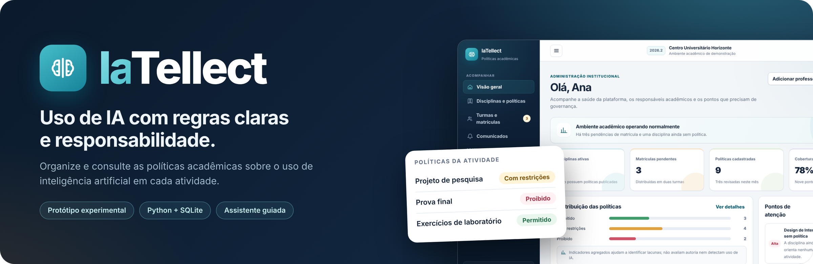
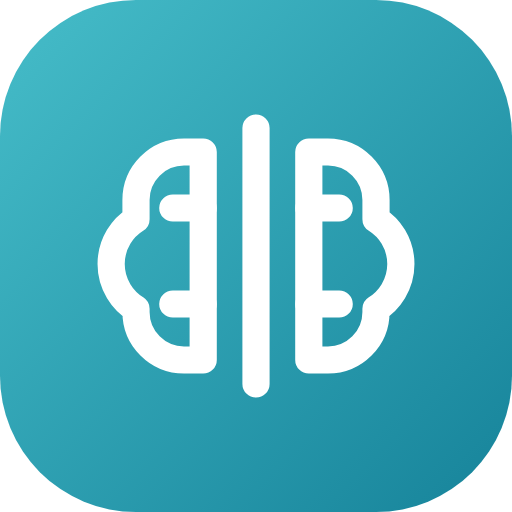
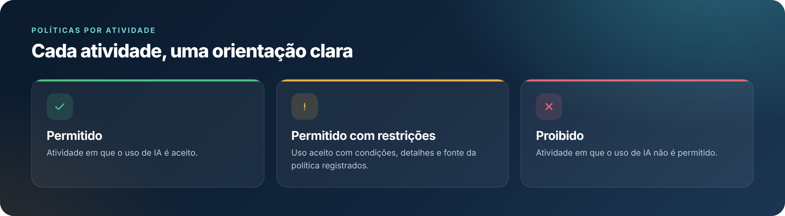
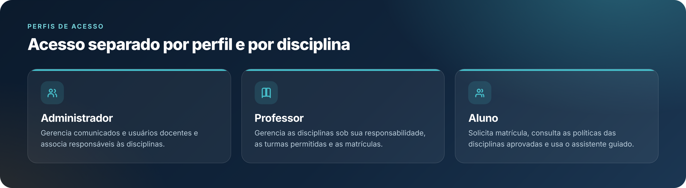
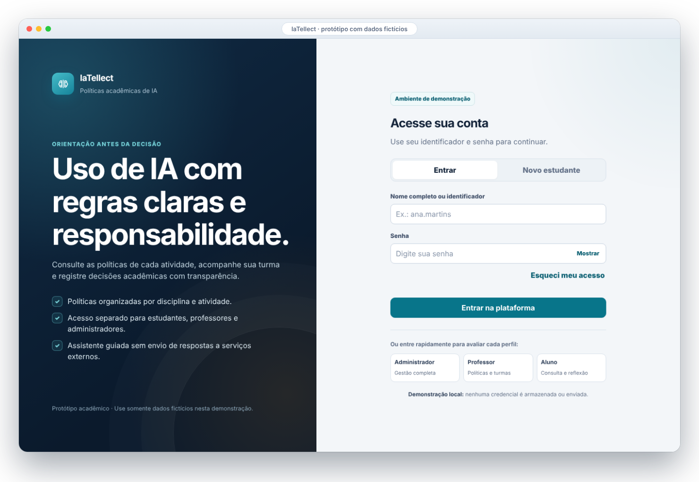
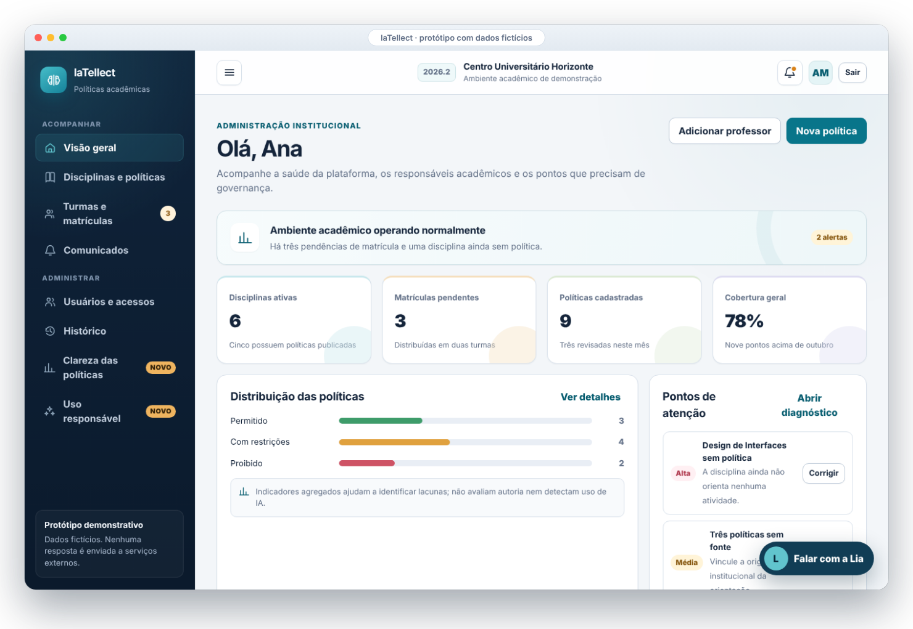
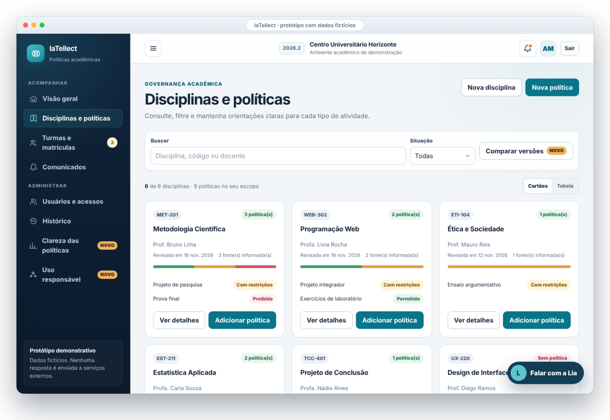
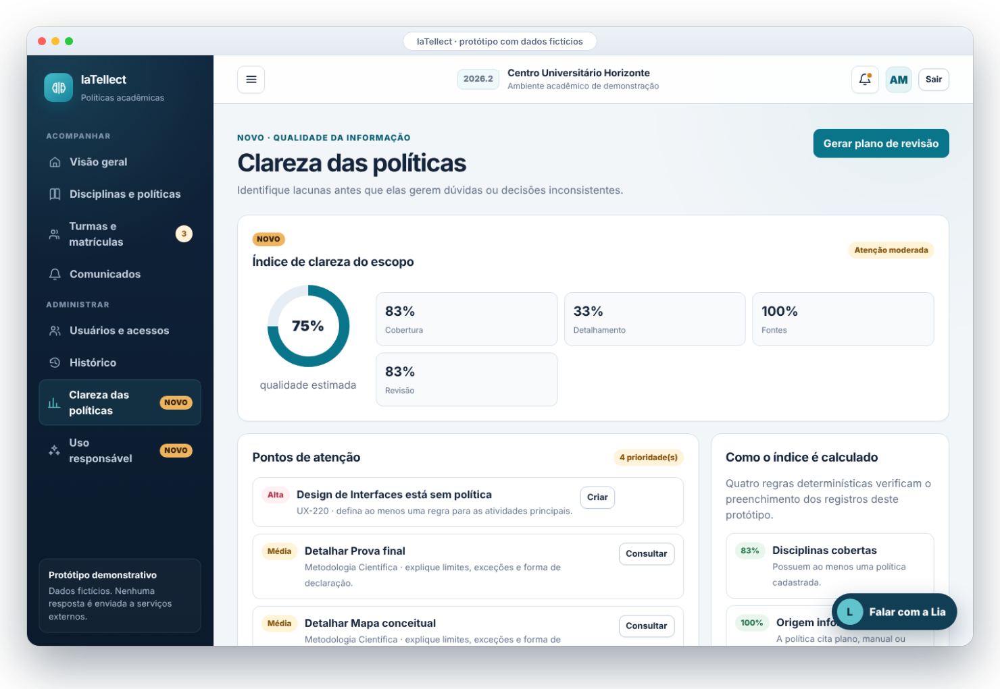
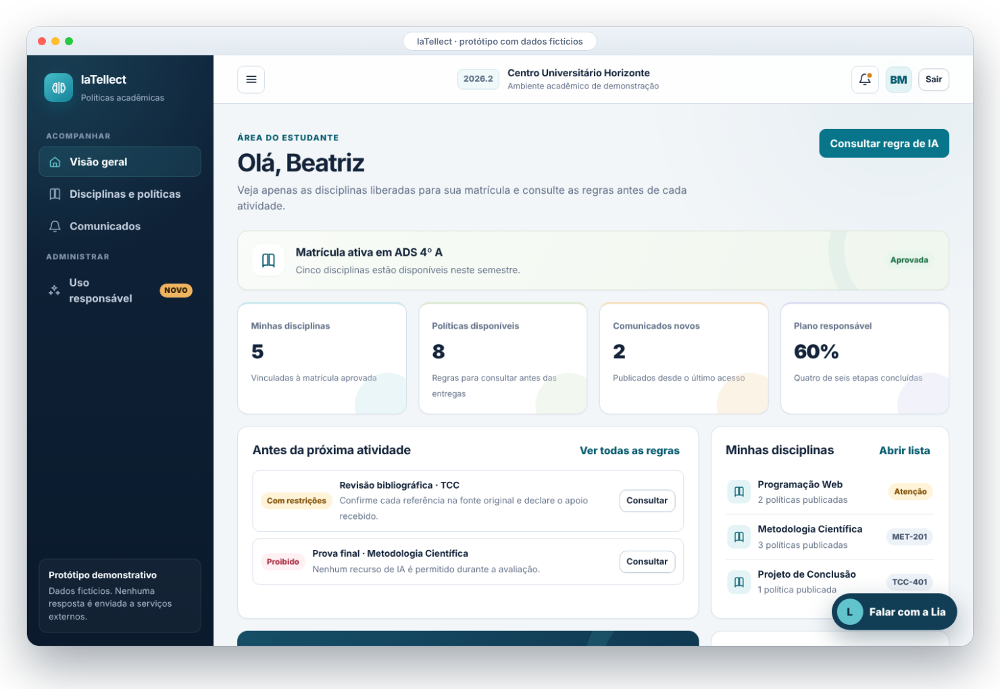
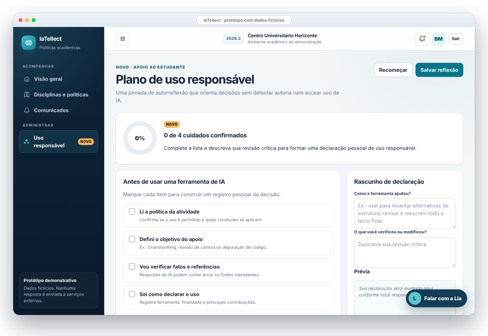

<p align="center">
  
</p>

<p align="center">
  <picture>
    <source srcset="docs/assets/readme/logo.svg" type="image/svg+xml">
    
  </picture>
</p>

# IaTellect

## Políticas acadêmicas de uso de IA

**Uso de IA com regras claras e responsabilidade.**

<p align="center">
  
  
  
</p>

Protótipo de uma plataforma para organizar e consultar políticas acadêmicas sobre o uso de inteligência artificial (IA) em atividades de disciplinas. O sistema permite registrar regras por atividade e apoiar a comunicação entre administração, docentes e estudantes.

> [!WARNING]
> **Status:** projeto experimental/em desenvolvimento. Não foi comprovada publicação institucional. Não utilize com dados reais de estudantes nem disponibilize publicamente como serviço sem revisar autenticação, privacidade, segurança, hospedagem e backups.

> [!NOTE]
> Este é um protótipo demonstrativo. Seus resultados ainda precisam ser avaliados em testes com usuários.

## Navegação rápida

- [O que o sistema faz](#o-que-o-sistema-faz)
- [Fluxo em três passos](#fluxo-de-consulta-em-três-passos)
- [Estados de política](#estados-de-política)
- [Versão recomendada](#versão-recomendada-para-experimentar)
- [Como executar](#como-executar-localmente)
- [Perfis de acesso](#perfis-de-acesso)
- [Galeria de telas](#galeria-de-telas)
- [Estrutura do repositório](#estrutura-do-repositório)
- [Testes](#testes)
- [Dados, privacidade e publicação](#dados-e-publicação-no-github)
- [Acessibilidade](#acessibilidade)
- [Próximos passos](#próximos-passos-recomendados)
- [Licença](#licença)
- [Guia de identidade visual](docs/guia-identidade-visual.md)

<p align="center">
  
</p>

## O que o sistema faz

- Registra disciplinas e políticas com um dos seguintes estados: **permitido**, **permitido com restrições** ou **proibido**.

- Permite informar atividade, condições, detalhes e fonte da política.

- Organiza turmas, disciplinas vinculadas e solicitações de matrícula, que podem ficar pendentes, ser aprovadas ou recusadas.

- Apresenta ao estudante as disciplinas associadas às matrículas aprovadas e permite consultar as políticas cadastradas.

- Inclui um **assistente guiado** de consulta e autorreflexão. Nesta versão, o fluxo segue regras e textos cadastrados; **não utiliza modelo generativo**, não envia respostas a serviços externos e não detecta nem comprova autoria ou uso de IA.

- Oferece gestão de comunicados e histórico de operações.

- Possui controles de acesso por perfil e por disciplina no servidor, além de testes automatizados de permissões.

### Fluxo de consulta em três passos

| 1. Selecionar disciplina | 2. Consultar regras | 3. Verificar o nível |
| :---: | :---: | :---: |
| Escolha a disciplina e o tipo de atividade acadêmica. | Consulte as políticas, condições, detalhes e fontes cadastradas. | Confirme se o uso de IA está permitido, permitido com restrições ou proibido. |

### Estados de política

| Estado | Identificação visual | Significado |
| --- | :---: | --- |
| **Permitido** |  | Atividade em que o uso de IA é aceito. |
| **Permitido com restrições** |  | Uso aceito com condições, detalhes e fonte da política registrados. |
| **Proibido** |  | Atividade em que o uso de IA não é permitido. |

> [!IMPORTANT]
> As cores ajudam a reconhecer os estados, mas não substituem seus rótulos. Verde, amarelo e vermelho não devem ser usados como decoração.

<p align="center">
  
</p>

<p align="center">
  
</p>

## Versão recomendada para experimentar

- **Executar a plataforma:** a [Plataforma v4.0 Final](Plataforma%20v4.0%20Final/README.md) usa Python e SQLite local para login, turmas e políticas.
A v4 serve o próprio [HTML do protótipo UX](prototipo-ux/index.html). Inicie o servidor para entrar, solicitar matrícula e consultar os dados do SQLite.

## Requisitos

- Windows para usar o arquivo de inicialização incluído (`iniciar.bat`).

- Python 3 instalado e disponível no `PATH`.

- Navegador web atualizado.

O servidor usa módulos da biblioteca padrão do Python, incluindo `sqlite3`; não é necessário instalar um servidor de banco de dados separado.

## Como executar localmente

No Windows, a partir da raiz do repositório:

```powershell
cd "Plataforma v4.0 Final"
.\iniciar.bat
```

Abra [a tela de acesso](http://127.0.0.1:3002/acesso.html). Também é possível iniciar com `python server.py` dentro da pasta da v4.

Na primeira execução, o administrador usa a senha de `ADMIN_PASSWORD` ou a senha gerada no arquivo local `data/senha_admin_inicial.txt`. Depois de entrar, altere a senha e apague esse arquivo.

<p align="center">
  
</p>

## Perfis de acesso

- **Administrador:** administra comunicados e usuários docentes e associa responsáveis às disciplinas.

- **Professor:** gerencia as disciplinas sob sua responsabilidade e as turmas permitidas; pode tratar matrículas e consultar as informações autorizadas para seu perfil.

- **Aluno:** solicita matrícula em uma turma. Depois da aprovação, pode consultar as disciplinas correspondentes e suas políticas.

<p align="center">
  
</p>

### Login de estudante

Na v4, o aluno entra com nome completo e senha. A aprovação da matrícula libera as disciplinas da turma. Para contas antigas sem senha, o administrador ou um professor autorizado pode usar **Definir senha**.

<p align="center">
  
</p>

## Galeria de telas

As imagens registram o desenho original da [interface](prototipo-ux/) com dados de demonstração.

> [!NOTE]
> As capturas de tela apresentam dados fictícios de demonstração.

| Acesso à plataforma | Visão geral administrativa |
| :---: | :---: |
|  |  |
| **Login e seleção do perfil de demonstração.** | **Indicadores acadêmicos e ações prioritárias.** |

| Disciplinas e políticas | Clareza das políticas |
| :---: | :---: |
|  |  |
| **Consulta das regras por disciplina e atividade.** | **Acompanhamento de cobertura, fontes e detalhamento.** |

| Área do estudante | Plano de uso responsável |
| :---: | :---: |
|  |  |
| **Disciplinas liberadas para a matrícula aprovada.** | **Jornada guiada de autorreflexão.** |

<p align="center">
  
</p>

## Estrutura do repositório

<details>
<summary><strong>Ver estrutura de pastas documentada</strong></summary>

```
Plataforma v4.0 Final/                         Plataforma funcional com Python e SQLite
prototipo-ux/                                  Interface da v4 servida pelo backend
BackLogs/                                      Planejamento e backlog do projeto
Desenvolvimento da Plataforma/
  Assistente de uso de IA - Protótipo/          Protótipo anterior
  Testes da Plataforma/                         Histórico dos protótipos v0.0 a v3.0
  Tela de Login/                                Experimentos visuais de login
  menu-acessibilidade/                          Componente de preferências de acessibilidade
  plataforma_terminal.py                        Protótipo de linha de comando
Referências para o projeto/                     Pesquisa e referências do projeto
```

Na v4, o banco fica em `Plataforma v4.0 Final/data/`. As versões anteriores têm armazenamento próprio.

</details>

## Testes

<details>
<summary><strong>Ver comando e informações da suíte de testes</strong></summary>

A pasta da v4 contém testes automatizados de autenticação, permissões, turmas e matrículas, visibilidade de dados e outras regras do servidor. Para executá-los, use:

```
cd "Plataforma v4.0 Final"
python test_permissoes.py
```

Os testes criam um banco temporário e não devem alterar o banco de desenvolvimento. A suíte da v4 inclui 108 verificações. Isso não substitui uma auditoria de segurança, testes de carga, validação de acessibilidade ou teste de implantação pública.

</details>

> [!IMPORTANT]
> Isso não substitui uma auditoria de segurança, testes de carga, validação de acessibilidade ou teste de implantação pública.

<p align="center">
  
</p>

## Dados e publicação no GitHub

> [!WARNING]
> O sistema guarda dados no arquivo SQLite local. Antes de enviar o repositório ao GitHub:

- Não inclua bancos de dados com dados reais, respostas de estudantes, anotações, senhas, tokens ou outros segredos.

- Revise se arquivos `.db`, `.db-wal` e `.db-shm`, arquivos de configuração local e variáveis secretas estão excluídos do versionamento.

- Use apenas dados fictícios em capturas de tela, demonstrações e bancos de exemplo.

- Não coloque `ADMIN_PASSWORD` nem outras credenciais no código, no histórico de commits, em screenshots ou neste README.

> [!IMPORTANT]
> O assistente registra respostas de autorreflexão localmente. Essas respostas são declarações dos próprios estudantes: não comprovam fatos, autoria ou uso de IA e não devem ser tratadas como decisões disciplinares automáticas. Antes de qualquer piloto com estudantes, é necessário definir finalidade, aviso de privacidade, controle de acesso, retenção e descarte dos dados.

## Acessibilidade

> [!NOTE]
> O repositório inclui um componente separado de preferências de apresentação, com opções como tema, tamanho da fonte, espaçamento, sublinhado de links, redução de movimento e alto contraste. Há referências de projeto a WCAG 2.2 e eMAG; a existência dessas opções e referências **não significa que o sistema esteja certificado ou que sua conformidade tenha sido validada**. São necessários testes automáticos e manuais, incluindo teclado, leitores de tela, contraste e avaliação com pessoas com deficiência.

<p align="center">
  
</p>

## Próximos passos recomendados

1. Validar os fluxos de cadastro e recuperação de acesso com estudantes e professores.

1. Definir e documentar regras de privacidade, retenção e descarte das respostas e anotações.

1. Revisar configuração de segredos, HTTPS, sessões e implantação antes de qualquer acesso externo.

1. Planejar hospedagem com armazenamento persistente, backups e testes de restauração.

1. Ampliar testes de segurança, acessibilidade, usabilidade e implantação.

1. Atualizar o backlog para refletir as implementações e pendências reais.

## Licença

> [!WARNING]
> Nenhuma licença de distribuição foi identificada nos arquivos analisados. Defina e inclua uma licença antes de autorizar reutilização, modificação ou redistribuição do código.

<p align="center">
  <strong>IaTellect — Políticas acadêmicas de uso de IA</strong><br>
  Projeto acadêmico — CESAR School
</p>
